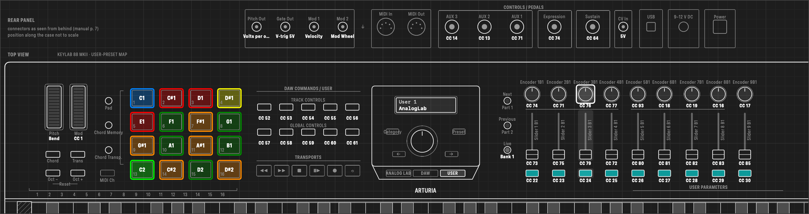

# KeyLab Manager

A native macOS app for editing the User presets of an **Arturia KeyLab 88 mkII** over USB MIDI SysEx — a replacement for MIDI Control Center, which is Intel-only and no longer runs on recent macOS.



## Features

- Blueprint-style drawing of the keyboard: click any pad, encoder, fader, button, wheel or rear jack to edit it. Values (CC, note, program change…) and pad colours are drawn on the controls.
- Table editor for every parameter of the selected group, with changed values highlighted.
- Edit all 10 User presets and the device-wide settings; write changes back and store them on the keyboard.
- Copy a preset to another User slot, export / import single presets.
- Full backup and restore of all presets to a JSON file.
- `klctl` command-line tool for scripting: read/write single values, dump, backup, restore, copy.

Tested with a KeyLab 88 mkII, firmware 1.3.1.84. Other KeyLab mkII sizes (49/61) use the same protocol and will probably work, but the drawing shows the 88.

## Build

Requires macOS 14+ and Xcode (the SwiftUI app needs the full Xcode, not just the Command Line Tools).

```sh
cd KeyLabManager
./build-app.sh            # → dist/KeyLab Manager.app and dist/klctl
./build-app.sh install    # also copies the app to ~/Applications
```

The app is ad-hoc signed; on first launch you may need to right-click → Open.

## Usage

Connect the keyboard over USB and start the app; it talks to the `KeyLab mkII 88 MIDI` port. Pick a User preset in the strip at the top, edit, then press **Write**. Making a backup first (**File → Back up all presets…**) is a good idea.

The app cannot switch which preset is *active* on the keyboard — no SysEx command for that is known. Select the preset on the keyboard itself.

```
klctl info                         device, firmware, preset names
klctl get  <preset> <bank> <param> <ctrl>      read one value (hex ids; preset 0 = global, 3-12 = User 1-10)
klctl set  <preset> <bank> <param> <ctrl> <v>  write one value and store the preset
klctl dump <user 1-10>             print every parameter of a User preset
klctl backup <file.json> [users]   save global + User presets
klctl restore <file.json> <from> <to>
klctl copy <from> <to>
```

## Protocol notes

Messages start with `F0 00 20 6B 7F 42`.

| Message | Meaning |
|---|---|
| `01 pr param ctrl` → `02 pr param ctrl val` | read a value (banks 2/3: command byte +0x30 / +0x40) |
| `02 pr param ctrl val` | write a value |
| `03 …` → `04 … chars 00` | read / write a text value (preset names) |
| `06 id` | store the edit buffer into preset `id` |

Preset ids: `0` = global settings / edit buffer, `3…12` = User 1…10. Reading or writing preset *N* loads it into the edit buffer, and changes are lost as soon as another preset is accessed, so `06 N` must follow the writes directly. After a store, reads of *N* return stale values until some other preset has been accessed.

## Credits

The parameter map (`KeyLabCore/Resources/kl2-schema.json`) is generated by `tools/gen_schema.py` from the UI definitions of [sysex-controls](https://github.com/soyersoyer/sysex-controls) by soyersoyer (GPL-3.0), which documented the protocol.

## License

GPL-3.0 — see [LICENSE](LICENSE).

Not affiliated with or endorsed by Arturia. KeyLab is a trademark of Arturia. Use at your own risk; back up your presets before writing.
